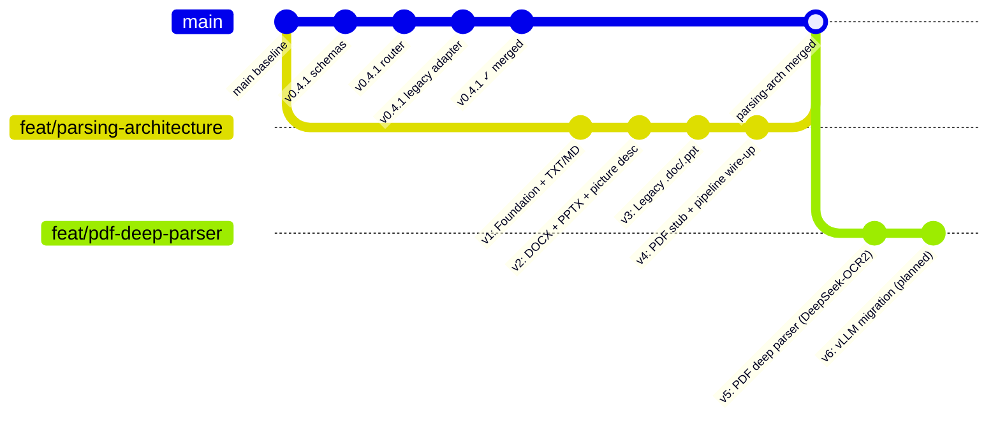

# Parsing Architecture — Branch Roadmap

**Branch:** `feat/parsing-architecture`
**Branches from:** `main` (runs in parallel with v0.4.1)
**Integration point:** Merges to `main` after **v4 completes** — that is when all formats are covered and the ingestion endpoint can be safely switched.

---

## Why a Separate Branch

The v0.4.1 plan changes the **API layer** (routing, schemas, status codes). This parsing architecture changes the **parsing + chunking layer** underneath it. They are independent — v0.4.1 can ship to main without waiting for parsing work, and parsing work does not depend on v0.4.1 being finished. Running them as separate branches lets both land in the right order without blocking each other.



---

## Version Sequence

| Version | Document | What it adds | Integration |
|---|---|---|---|
| **v1** | `v1.md` | `BaseParser` abstract, `TextParser` (TXT/MD via `convert_string`), `ParserRouter` scaffold, `HybridChunker` in `Chunker` | Internal only — ingestion endpoint unchanged |
| **v2** | `v2.md` | `DoclingParser` for `.docx` + `.pptx`, router updated; `HybridChunker.serialize()` critical fix; lightweight local picture description (SmolVLM-256M / Granite-Vision via Ollama) | Internal only |
| **v3** | `v3.md` | `LibreOfficeConverter` for `.doc`/`.ppt`, router updated | Internal only |
| **v4** | `parsing_arch_v4_pdf_stub.md` | `PdfStubParser` for `.pdf`, router covers all formats → **ingestion endpoint switched to `parser_router`** | **Branch merge to main** |
| **v5** | `parsing_arch_v5_pdf_deep.md` | `PdfPageRouter` (per-page triage, PyMuPDF4LLM, Docling, DeepSeek-OCR2) | Separate branch off main post-merge |
| **v6** | `parsing_arch_v6_vllm_migration.md` | Migrate DeepSeek-OCR2 serving from HF Transformers (v5) to vLLM for production batch throughput on PDF per-page OCR/VLM tier | Continuation off v5, after v5 is functional. **v6 is a planned future version only — not executable on current dev hardware (GTX 1650, 4GB VRAM). Full planning deferred until v5 is near-complete.** |

---

## Rules Across All Versions

- **No regression.** Every version must pass `tests/v0.3/` and `tests/v0.4/` unchanged.
- **Public API contract never changes.** `POST /api/v1/documents` response schema, HTTP status codes, and legacy routes are frozen.
- **Comment preservation mandate.** No existing comment or docstring in any modified file is removed or reworded. New comments may be added.
- **Additive only.** Each version adds files or extends existing ones. Nothing is deleted until a later version explicitly retires it.
- **`core/parser.py` stays alive** until v4 integration. Legacy routes in `api/legacy.py` always call the old `Parser` — the new `ParserRouter` is only used from the new v1 ingestion path.

---

## Dependency Chain

```
v1 Foundation
    └── v2 DOCX/PPTX + picture desc (requires BaseParser + DoclingParser)
            └── v3 Legacy (requires LibreOfficeConverter + DoclingParser from v2)
                    └── v4 PDF stub + pipeline (requires all formats + HybridChunker from v1)
                            └── v5 PDF deep (requires PdfPageRouter + eval harness)
                                    └── v6 vLLM migration (requires v5's DeepSeek-OCR2 integration working first)
```

---

## File Ownership Per Version

| File | Owner Version | Action |
|---|---|---|
| `core/parsers/__init__.py` | v1 | [NEW] |
| `core/parsers/base.py` | v1 | [NEW] |
| `core/parsers/text_parser.py` | v1 | [NEW] |
| `core/parser_router.py` | v1 | [NEW] scaffold |
| `core/chunker.py` | v1 | [MODIFY] add HybridChunker path |
| `config.py` | v1 | [MODIFY] chunker_tokenizer |
| `core/parsers/docling_parser.py` | v2 | [NEW] |
| `core/parser_router.py` | v2 | [MODIFY] add .docx/.pptx |
| `core/parsers/libreoffice_converter.py` | v3 | [NEW] |
| `core/parser_router.py` | v3 | [MODIFY] add .doc/.ppt |
| `core/parsers/pdf_stub.py` | v4 | [NEW] |
| `core/parser_router.py` | v4 | [MODIFY] add .pdf |
| `api/dependencies.py` | v4 | [MODIFY] add parser_router singleton |
| `api/v1/endpoints/documents.py` | v4 | [MODIFY] switch to parser_router |
| `config.py` | v2 | [NEW] picture-description model settings (SmolVLM-256M primary preset, Granite-Vision-3.3-2B via Ollama as escalation — see v2.md) |
| `core/parsers/pdf_router.py` | v5 | [NEW] |
| `core/parser_router.py` | v5 | [MODIFY] swap .pdf to PdfPageRouter |
| `config.py` | v5 | [NEW] DeepSeek-OCR2 settings — first appearance of DeepSeek-OCR2 in the codebase, PDF branch only |
| `config.py` | v6 | [MODIFY] DeepSeek-OCR2 serving settings — migrate from HF Transformers to vLLM |

---

## Test Directory Structure

```
tests/
├── v0.3/          (locked — never touch)
├── v0.4/          (locked — never touch)
└── parsing_arch/
    ├── v1/        (Foundation + TXT/MD)
    ├── v2/        (DOCX + PPTX + picture description + serialize() fix)
    ├── v3/        (Legacy formats)
    ├── v4/        (PDF stub + pipeline)
    ├── v5/        (PDF deep parser)
    └── v6/        (vLLM migration — placeholder, empty until v5 is near-complete)
```

Each version's test directory is created alongside its plan document.
